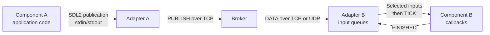

# Runtime execution, ticks and message flow

This document describes the default `realtime` engine. The
[simulated engine](simulation.md) runs the same component callbacks with a central
virtual clock, deterministic publication barriers and optional parallel workers.

A **tick is one processing cycle of a modeled component**. Its adapter selects
the input values for that cycle, sends them to the component, requests execution
and waits for the component to report completion.

Each component has its own ticks. The model determines whether they are triggered
by input changes or a periodic deadline. Different components can process their
ticks concurrently.

## Runtime actors

Three actors participate in a message exchange:

| Actor | Responsibility |
| --- | --- |
| Component | Executes application code: acquisition, calculation, filtering, display, and so on. |
| Component adapter | Handles network reception, input queues, acknowledgements, scheduling and local communication with the component. |
| Broker | Routes publications to subscriptions and manages an independent delivery queue and policy for each subscription. |

The current implementation runs each component and its Python adapter as two
separate processes. The supervisor hosts the broker and launches the adapters.
The component process can use Python, C, Rust, Java or Ada.



The local adapter/component exchange uses the binary CH/1 protocol over
stdin/stdout. Broker exchanges use CENV/1, with an S2PS/2 envelope containing
the catalogue identity and SDL2 message bytes. The adapter adds or removes that
envelope at the network boundary.

## Startup

1. The supervisor starts the broker and one adapter per component.
2. Each adapter connects to the broker, prepares its subscription connections
   and starts its component process.
3. The adapter sends INIT with the component configuration, parameters and port
   catalogues.
4. A generated container initializes its codecs and application handler, runs
   the optional `on_start` callback and sends READY after successful initialization.
5. The adapter reports readiness to the broker.
6. Once all modeled components are ready, the supervisor enables publications
   and delivery. Adapters can then schedule their components' ticks.

A required input can still be empty at this point. It prevents processing until
data is available or its configured timeout expires, but does not prevent
initialization or READY. External client
sessions do not participate in this startup barrier.

## From publication to an input queue

Consider a measurement published by `acquisition` for `analyse`:

1. During a tick, the acquisition callback creates a typed message and calls its
   generated publication function.
2. The container encodes the message with the output's SDL2 catalogue and sends
   a local PUBLISH frame to its adapter.
3. The adapter adds the S2PS/2 envelope and sends a TCP publication request to
   the broker for the output topic, such as `acquisition.measure`.
4. The broker validates the message and finds subscriptions to that topic.
5. For each subscription, it attempts admission to an independent broker queue,
   applying that subscription's buffer and overflow policy. A publication result
   reports the admission outcome for each subscription.
6. A send loop for each subscription transmits queued DATA messages over its
   configured TCP or UDP transport. TCP subscriptions have separate data
   connections so a blocked data receiver does not block control replies.
7. The destination adapter checks the topic, catalogue identity, SDL compatibility
   with the input contract and payload validity, then attempts admission to that
   input's RAM buffer.

There are two main queues along this path: the broker's subscription queue and
the destination adapter's input buffer. A bounded staging queue also separates
network reception from input admission. Each input subscription has its own
admission worker.

Admission and sending run independently across subscriptions. Their progress
can overlap with the publication reply; the reply and all recipients' processing
do not form a single synchronized operation.

A message admitted to an input buffer is available for a future tick. Its arrival
alone does not invoke the modeled component's application callback.

## Building a tick's input snapshot

The adapter's scheduler examines the input buffers and selects:

| Input | Value selected for a tick |
| --- | --- |
| FIFO | The first queued message, at most one per input. |
| Latest state | The current value, which remains available across ticks. |
| Empty optional input | No value; generated Python snapshot callbacks receive `None`. |
| Empty required input with an expired `timeout` | An explicit null value passed to the existing processing callback. |

Every required input must have a value or an expired configured timeout before
the tick can start. Without timeouts, two required FIFO inputs need at least one
queued message in each. A required latest input needs an initial value or a
timeout; once a value is present, later ticks can reuse it.

For example, a component might combine a FIFO of measurements with a latest-state
setpoint:

| Moment | Measurement FIFO | Latest setpoint | Tick snapshot |
| --- | --- | --- | --- |
| Tick 1 starts | M1, M2, M3 | C10 | M1 + C10 |
| Tick 1 is running | M2 and M3 wait; M4 arrives | C11 arrives | Tick 1 keeps M1 + C10 |
| Tick 2 starts | M2, M3, M4 | C11 | M2 + C11 |
| Tick 3 starts | M3, M4 | C11 | M3 + C11 |

Selected input values remain stable for the duration of the tick. A newly received
setpoint changes the buffer for a future tick, not the snapshot already passed
to the component.

The snapshot groups values available at selection time. It does not match them
by timestamp, measurement number or publication sequence. Applications that need
such matching must implement the corresponding synchronization logic.

## Required-input timeouts

Set `timeout` on a required input to bound its wait for usable data. The value is
in seconds, accepts fractional values and must be finite and strictly positive:

```json
{
  "inputs": {
    "a": {"root": "Measurement", "required": true, "timeout": 0.5},
    "b": {"root": "Measurement", "required": true, "timeout": 1.0}
  },
  "outputs": {},
  "trigger": {"mode": "on_change"}
}
```

`required` defaults to `true`. Optional inputs and output ports cannot declare a
timeout. Required inputs without `timeout` retain their existing unbounded wait
and still need an explicit producer binding in the model. A timeout does not
replace that binding requirement.

Each required input's deadline is armed when the adapter starts execution after
the chain's READY barrier. At selection time, an available record is used even
if the deadline has already passed. An empty input whose deadline has expired
contributes a null value. A tick becomes eligible once every required input has
a value or an expired timeout. Other required inputs and a periodic trigger can
therefore delay invocation beyond one input's individual deadline. In the example,
if both inputs remain empty, the first tick becomes eligible after one second.

The existing processing callback receives the null directly:

```python
def on_tick(ctx, inputs):
    a, b = inputs["a"], inputs["b"]
    if a is None:
        handle_missing_a(ctx)
    if b is None:
        handle_missing_b(ctx)
```

A named callback for a timed input is likewise called with `None` in Python,
`NULL` in C or `None` through `Option<&Message>` in Rust. There is no separate
timeout callback, timeout flag or event argument. Absent optional inputs keep
their existing behavior: their named callbacks are skipped.

After each successful tick, the adapter rearms the configured deadlines from the
completion time. Callback execution and publication admission waits do not consume
the next tick's timeout budget. If inputs remain empty, subsequent ticks can
report null again after their new deadlines; the scheduler does not spin on an
already expired deadline. Arrivals during a null tick stay queued for a later tick.

The timeout bounds waiting for a value; it does not expire received records.
An existing latest-state value stays usable indefinitely and is not replaced
with null because no further publications arrive. A timeout is also independent
of the subscription's ACK timeout and overflow admission wait.

Null values are generated locally by the adapter. They are not SDL messages,
are not published through the broker and do not create network ACKs or retries.
The local INPUT frame has an empty catalogue and empty payload to represent the
null. A missing required INPUT frame still fails, even on a timed input; generated
containers also reject explicit nulls for inputs without a timeout.

## Executing and completing a tick

The local exchange for a two-input tick is:

```text
Adapter -> component: INPUT measurement = M1
Adapter -> component: INPUT setpoint = C10
Adapter -> component: TICK

    The application callbacks run with the decoded inputs.
    They can publish zero, one or several output messages.

Component -> adapter: PUBLISH result = R1
Component -> adapter: FINISHED
```

The adapter reserves all selected FIFO records before sending the first INPUT.
They remain counted in the input buffers and cannot be evicted by `drop_oldest`
while the tick is in flight. The adapter removes them after receiving FINISHED.
Latest-state values remain available for subsequent ticks.

A component executes one tick at a time. While its application code is running,
the adapter continues receiving and admitting subsequent messages into its
bounded buffers.

Depending on the container implementation, input decoding happens while INPUT
frames are collected or when TICK is received. Application callbacks start after
TICK with the complete decoded snapshot.

Generated containers handle callback dispatch and the completion protocol:

- In Python and C, a supplied `on_tick` callback handles the complete snapshot;
  otherwise, named `on_<port>` callbacks handle the available inputs in model
  port order.
- In Rust, the default snapshot callback dispatches to the named input methods;
  the application can override it to process the whole snapshot.
- A source with no inputs implements a tick callback and uses a periodic trigger.
- Callbacks are synchronous. FINISHED is sent after the callbacks complete
  successfully. A callback failure stops the component without FINISHED.

Publication through the generated component context is allowed during tick/input
callbacks. See [callback containers](callbacks.md) for language-specific signatures
and input lifetimes.

## When ticks start

### Input changes: `on_change`

An `on_change` component becomes eligible once every required input has a value
or an expired configured timeout, and at least one selected input has work:

- a FIFO has a pending message; or
- a latest-state input has a different publication ID from the value processed
  in the previous tick; or
- an empty required input's configured timeout has expired.

After a tick completes, the next can start immediately if these conditions still
hold. With only latest-state inputs, unchanged values do not repeatedly trigger
execution. With multiple required FIFOs, one nonempty queue cannot trigger a tick
while another required queue is empty and still waiting for data or a timeout.

### Periodic execution: `periodic`

A periodic component becomes eligible when its deadline has been reached and
all required inputs have a value or an expired timeout. It can process an
unchanged latest value again on each tick.

The current scheduler sets the next deadline when the adapter completes a tick:

```text
next_tick = completion_time + period_ms
```

A period of 20 ms therefore introduces a 20 ms wait after completion. If a tick
takes 3 ms, the interval between successive tick starts is approximately 23 ms,
plus other execution delays. Tick duration can include publication admission
waits. This is a fixed delay after completion, not a fixed-rate clock.

The first tick can run as soon as execution is enabled and its required inputs
have values or expired timeouts. Missed periods do not accumulate into a backlog
of timer events.

## Admission, acknowledgement and processing completion

These confirmations describe different stages:

| Event | Meaning |
| --- | --- |
| Publication result `accepted` | The broker admitted the publication into RAM for that subscription. |
| ACK `received` | The destination adapter validated the message and admitted it into its input buffer in RAM. |
| FINISHED | The component completed the application processing for its tick. |

An ACK can reach the broker before the application callback starts. It does not
confirm completion of that callback or survival of a crash. Conversely, a
publication result does not wait for all downstream components to finish.

For an acknowledged subscription, the broker retains a pending sender record
until an ACK arrives or its configured attempt budget is exhausted. If the ACK
does not arrive by the deadline, the retry policy allows a bounded number of
retransmissions. The receiving adapter recognizes duplicates using its bounded
RAM history and does not admit them again within that window. A recognized
duplicate can be ACKed again if the previous ACK was lost.

Without acknowledgement, the broker removes the sender record after sending it.
An admitted message can subsequently be replaced by an overflow policy or lost
when its process stops. All queues, retained states, retry state and deduplication
history are volatile.

## Concurrent components and publication visibility

Each component has its own execution cycle. After startup, there is no global
barrier that waits for all components to complete a tick before starting the next
one. Acquisition can produce a new measurement while analysis processes the
previous one and display handles an earlier result.

A tick can publish results before sending FINISHED. A downstream component may
already process such a result while the upstream tick is still in flight.
Publications already emitted are not rolled back if the upstream component later
fails. A tick is a local processing cycle, not a transaction across the graph.

The adapter waits for each publication's broker reply before continuing its
output-reading loop. Admission refusals are recorded and reported; they do not
automatically cause that tick to be retried or prevent a later FINISHED from
consuming its selected FIFO inputs.

## Backpressure and ordering

When a consumer cannot keep up, its bounded queues apply their configured policy:

| Policy | Behavior |
| --- | --- |
| `reject_new` | Refuse a new message when the queue is full. |
| `drop_oldest` | Evict the oldest record that is not reserved by a running tick. Refuse if no such record is available. |
| `wait` | Wait for space up to a configured deadline, then refuse if the queue is still full. UDP does not support this policy. |
| `latest` | Keep the most recent admitted state for subsequent selection. A running tick retains its previously selected value. |

Broker admission waits can delay an emitter's publication and prolong its tick.
Each subscription's admission and send loops remain independent, although an
emitter's publication reply includes the outcomes of all matching subscriptions.

FIFO preserves admission order within a queue. UDP loss and retransmission can
make that order differ from publication order. The current implementation does
not reorder messages by sequence number before FIFO admission. Retries provide
bounded additional delivery attempts, not a guarantee of processing in original
publication order.

## The acquisition example

The model in [examples/acquisition/model.json](../examples/acquisition/model.json)
uses these execution patterns:

| Component | Trigger and inputs | Runtime behavior |
| --- | --- | --- |
| `acquisition` | Periodic, 20 ms; no inputs | Produces a measurement during each tick. |
| `analyse` | On change; measurement FIFO | Processes one measurement per tick and publishes a result. |
| `observation` | On change; result FIFO | Processes each result admitted and retained in its FIFO. |
| `affichage` | Periodic, 100 ms; latest result | Reads the latest available result and can skip intermediate values. |

The acquisition-to-analysis link uses TCP. The two result subscriptions use UDP,
with ACKs and retries for observation and latest-state delivery without ACKs for
display. Their different policies do not change the component protocol.

## External client callbacks

The [external client SDKs](clients.md) use a separate execution interface. Their
callbacks are invoked for admitted messages, sequentially per subscription, with
independent workers across subscriptions. They do not use the modeled component
tick scheduler or exchange local INPUT/TICK/FINISHED frames.

An external client can still publish into a topic bound to a modeled input. That
message then participates in the destination component's normal buffering and
tick-selection rules.

## Implementation references

- [Scheduler](../src/chain_env/execution/scheduler.py): input selection, change
  detection and periodic deadlines.
- [Adapter](../src/chain_env/execution/adapter.py): network admission, snapshot
  reservation, INPUT/TICK exchange, publications and completion.
- [Broker](../src/chain_env/execution/broker.py): routing, per-subscription queues
  and independent send loops.
- [Delivery engine](../src/chain_env/delivery/engine.py): ACKs, retry deadlines
  and exhaustion.
- [Component protocol](../sdk/protocol.md): binary frame layout and lifecycle.
