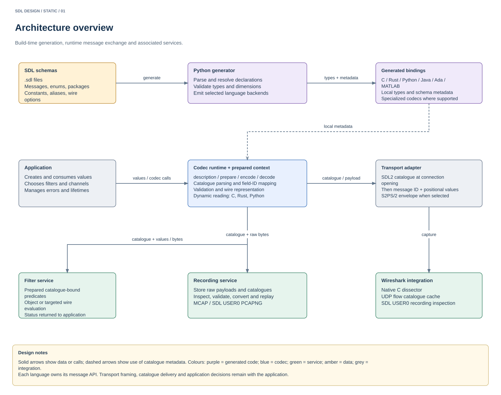
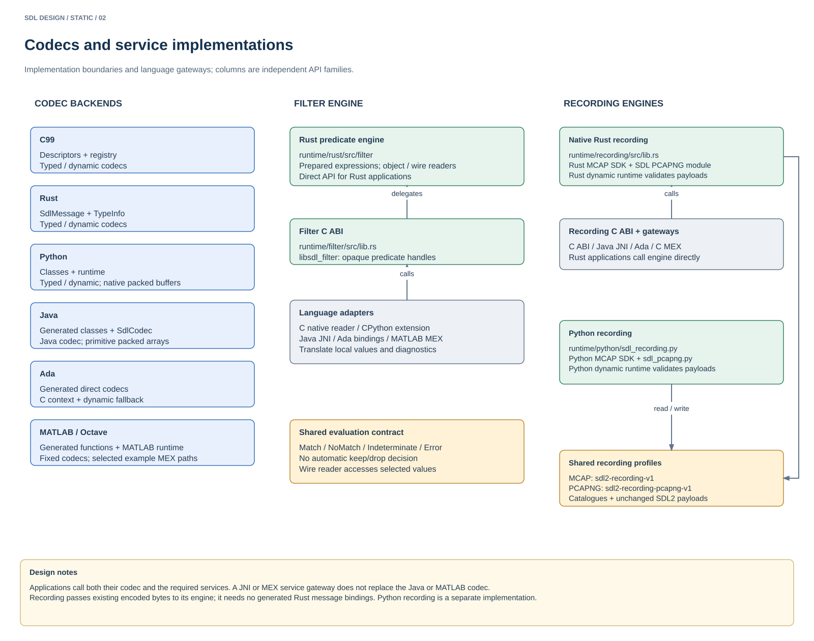
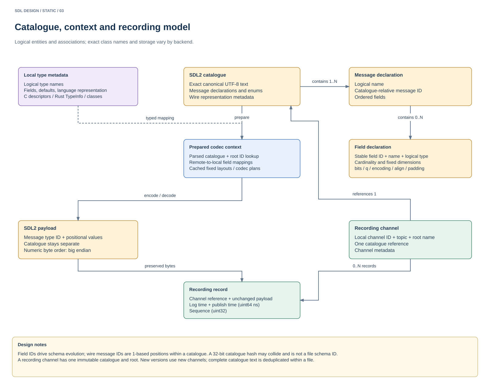
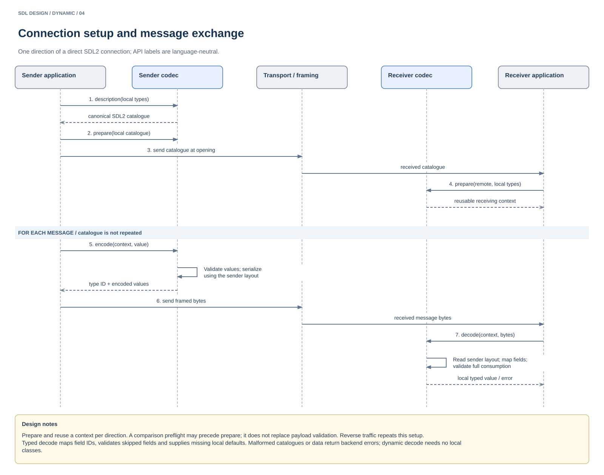
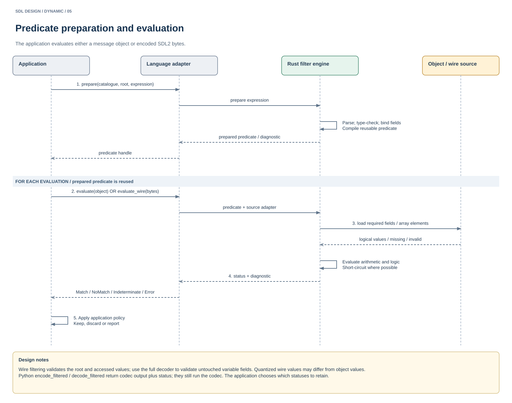
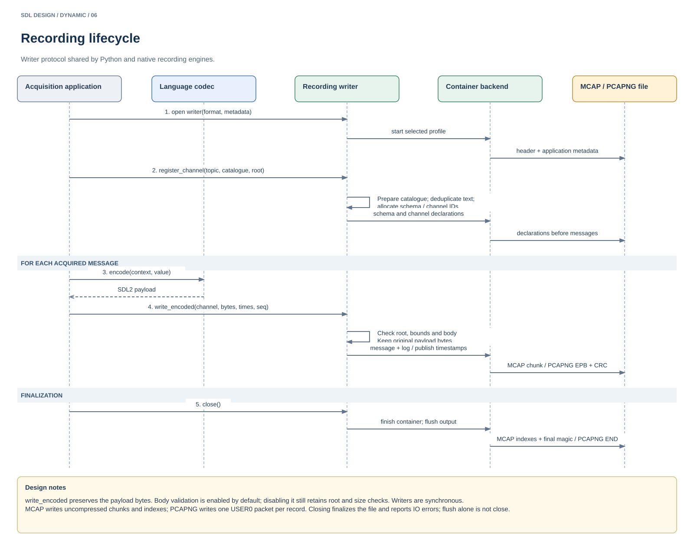
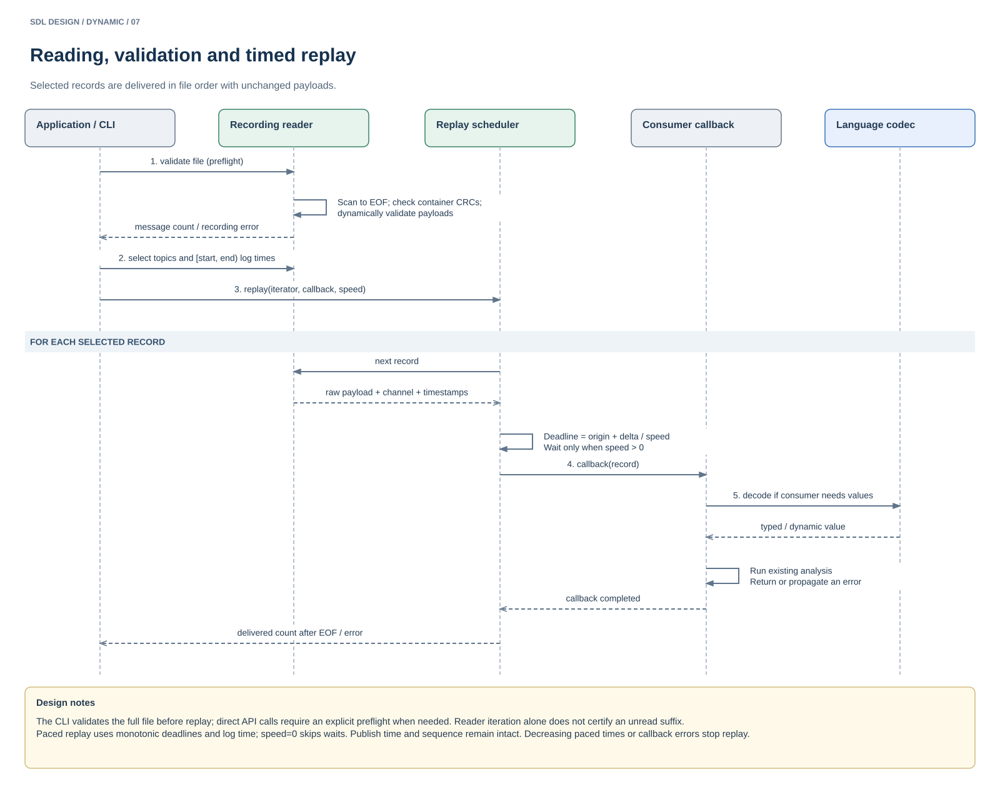
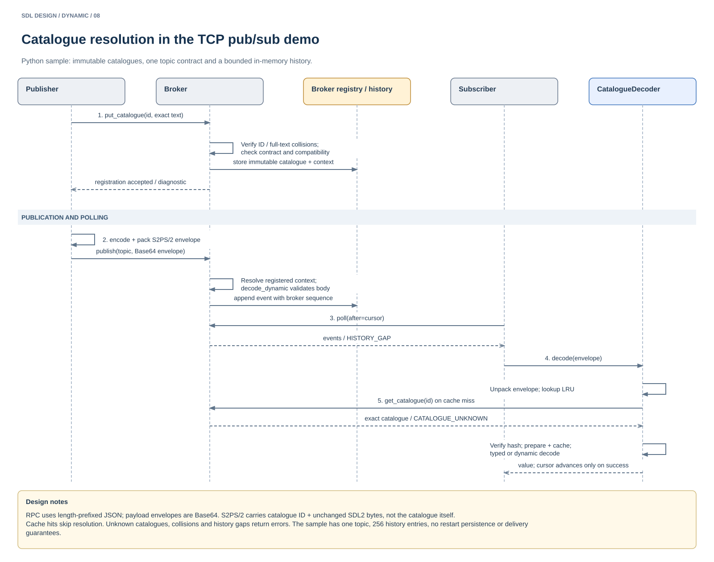

# SDL graphical design

Open [sdl-design.drawio](diagrams/sdl-design.drawio) in draw.io / diagrams.net. It contains eight editable pages: three static views and five sequence diagrams. SVG previews below can be viewed independently.

The diagrams describe the implemented architecture. API labels are language-neutral; logical entities summarize backend-specific classes and structures. The TCP pub/sub views describe the Python demonstrator.

| Page | View | Focus |
| --- | --- | --- |
| 01 | Architecture | Schemas, generation, codecs, transport and services |
| 02 | Implementations | Codec backends, shared engines and language gateways |
| 03 | Logical model | Catalogues, field IDs, contexts, channels and records |
| 04 | Codec exchange | Connection setup, encoding, transport and decoding |
| 05 | Filtering | Predicate preparation, object/wire evaluation and status |
| 06 | Recording | Channel registration, raw payload storage and close |
| 07 | Replay | File validation, selection, scheduling and callbacks |
| 08 | Pub/sub demo | Registration, publication, polling and catalogue resolution |

## Static design

### 01 — Architecture

The generator produces local types and metadata. Applications prepare codec contexts, exchange catalogues and send message data through their transport adapter. Filter, recording and inspection services operate on these descriptions and values.

References: [generation](../README.md#generate-bindings), [runtime APIs](runtime.md), [wire layout](wire_descriptor.md).

### 02 — Implementations

Each language retains its codec. Filtering uses the Rust predicate engine, directly or through the C ABI and language adapters. Recording has a Rust engine with native gateways and an independent Python implementation.

References: [backend APIs](runtime.md), [Ada integration](ada.md), [filter deployment](filtering.md#apis-and-deployment), [native recording](recording_native.md).

### 03 — Logical model

Catalogues describe message layouts; contexts map these layouts to local types. Field IDs support evolution, while wire message IDs select catalogue declarations. Recording channels reference a catalogue and root; records preserve payloads and timestamps.

References: [C type descriptors](../runtime/c/type_descriptors.h), [context API](../runtime/c/sdl_context.h), [recording model](recording.md#container-mapping).

## Dynamic design

Sequence diagrams read from top to bottom. Solid arrows represent calls or transfers; dashed arrows represent responses. Vertical dashed lines show participant lifetimes, and shaded bands identify repeated phases. Error outcomes appear in messages and design notes.

### 04 — Codec exchange

Prepare reusable contexts during connection setup. For each message, encode against the sender catalogue and decode against that catalogue plus local types. Fast codecs handle eligible matching layouts; generic decoding handles field mapping and schema evolution.

References: [runtime lifecycle](runtime.md), [automatic codecs](runtime.md#automatic-fixed-layout-codecs), [Python implementation](../runtime/python/sdl_runtime.py).

### 05 — Filtering

Prepare and bind the predicate once, then evaluate objects or selected wire values. The service returns a status and diagnostic; the application decides how to handle them. Rust uses the engine directly; other languages use adapters.

References: [filter semantics](filtering.md), [Python helpers](../runtime/filter/python/sdl_filter.py), [Rust engine](../runtime/rust/src/filter/mod.rs).

### 06 — Recording

Open the writer and register channels before their messages. Write existing SDL2 payloads with timestamps and sequence numbers, then close to finalize the selected container. Payload validation does not alter the recorded bytes.

References: [Python writer](../runtime/python/sdl_recording.py), [native recording behavior](recording_native.md#shared-behavior), [PCAPNG profile](recording_pcapng.md).

### 07 — Replay

Validate the file, select records by topic and log time, and deliver unchanged payloads to a consumer callback. The scheduler uses monotonic deadlines for paced replay. Decoding is a consumer choice; callback errors stop delivery.

References distinguish the CLI's automatic preflight from direct API replay, where the caller explicitly requests it.

References: [replay semantics](recording.md#timestamps-and-ordering), [CLI](../tools/recording/sdl-recording), [native replay](recording_native.md#shared-behavior).

### 08 — Pub/sub demo

The broker checks catalogue identities and topic compatibility before registration, then validates publications and stores bounded history. Subscribers poll by cursor and resolve catalogues on cache misses before typed or dynamic decoding.

References: [demo and limits](../samples/PoC_PubSub/README.md), [broker and clients](../samples/PoC_PubSub/pubsub.py), [resolution helper](../samples/PoC_PubSub/resolution.py), [S2PS/2 envelope](pubsub_envelope.md).

## Editing

All diagram shapes, labels, connectors and lifelines are editable in the draw.io file. After editing a page, export it as SVG to update its corresponding preview. Keep the eight page names and preview filenames aligned with this document.
